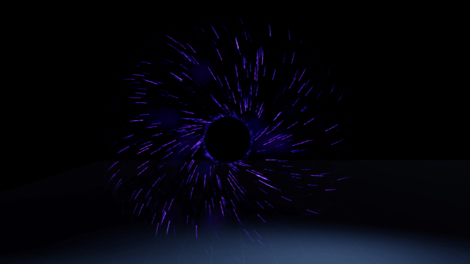
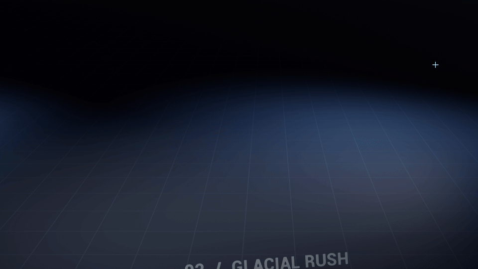
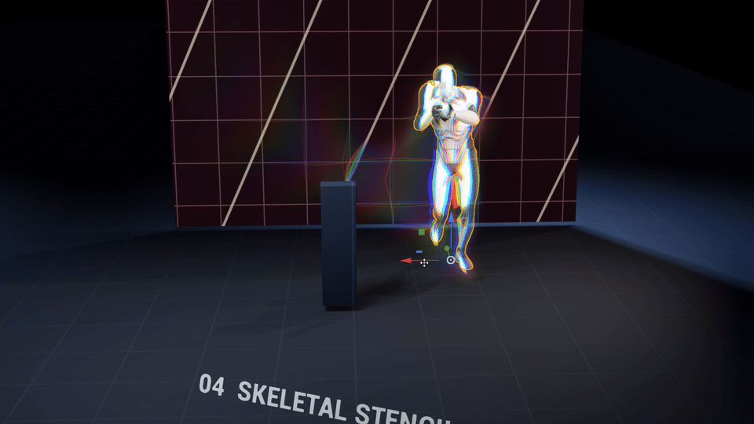

Toy case for Niagara automation pipeline

Vedio Link: todo

## Custom HLSL module authoring

AutoFlow can create reusable Module Script assets with typed inputs/outputs and a multiline Custom HLSL body. It also reads/updates managed definitions and validates them in a system containing an enabled module instance, including GPU shader compilation. Failed validated updates can restore and recompile the previous definition.

This feature requires the small UE 5.8.4 NiagaraEditor bridge recorded in [EnginePatches/UE5.8.4-NiagaraScriptAuthoring.diff](EnginePatches/UE5.8.4-NiagaraScriptAuthoring.diff). See [patch installation, API workflow and definition example](EnginePatches/README.md). The manifest records the base engine revision and hashes of the two added engine files.

Tools: `CreateModuleScriptFromHlsl`, `GetModuleScriptDefinition`, `UpdateModuleScriptDefinition`, `ValidateModuleScript`.

Creation is unsaved and unvalidated: attach the module with the official `AddModule`, then validate it in each required CPU/GPU context. Save the system separately. Context-free updates do not compile or automatically recover from compile failures. Arbitrary hand-authored graphs, Scratch Pad, Data Interfaces and includes are outside this version.

## Example prompt(Chinese):

|Prompt|Result|
|:--:|:--:|
|制作以紫黑色为主的黑洞传送门。中心周围具有明亮的视界、涡流和疏密变化的粒子。粒子应具有明确的切向旋转、向心加速和进入中心后消失的过程。其余细节可自由发挥。||
|制作从 Spawn 点向目标点快速生成的冰柱技能。通过 Niagara System 的世界空间 Position 类型参数 User.TargetPosition 传入终点，冰柱沿路径由小到大生长，并适当前倾。使用多种冰柱 Mesh，加入独立的高度、宽度、旋转与横向散布变化，避免重复排列。补充沿路径依次喷出的碎冰、水汽，以及使用 Mesh Renderer 渲染 Plane 的地面冰霜；冰霜先于冰柱扩散，随后逐渐消退。制作相应的冰晶材质，表现不规则表面裂纹、折射、透光与霜化||
|制作类似 《控制》 中的色散流体效果。可按照以下两种思路执行：1.使用 Skeletal Mesh NDI 采样 UE 小白人 Manny 蒙皮后的世界空间顶点位置和速度，投影到平面上。在发射器下创建Grid2D，使用自定义Module Script以及Custom HLSL来做流体模拟。最后的结果输出到RT上，并创建后处理材质在屏幕空间上显示效果。 2.使用Stencil写入单独标志位，在Niagara中通过GBuffer采样的NDI来读取流体的2D输入。后续模拟与输出流程同方案1。 两套方案均需满足： 使用 Blur 模拟扩散，半拉格朗日法处理平流；压力求解采用半径可调的可分离高斯核，通过横向、纵向两趟卷积近似，不使用 Gauss-Seidel 迭代。 保留原始输入深度，并随流体传输。后处理阶段将二维结果重建到对应世界空间位置，结合场景深度处理遮挡，使平面模拟具有空间层次。 采样原始 SceneColor，结合流场进行折射与 RGB 色散，具体风格可自由发挥。||